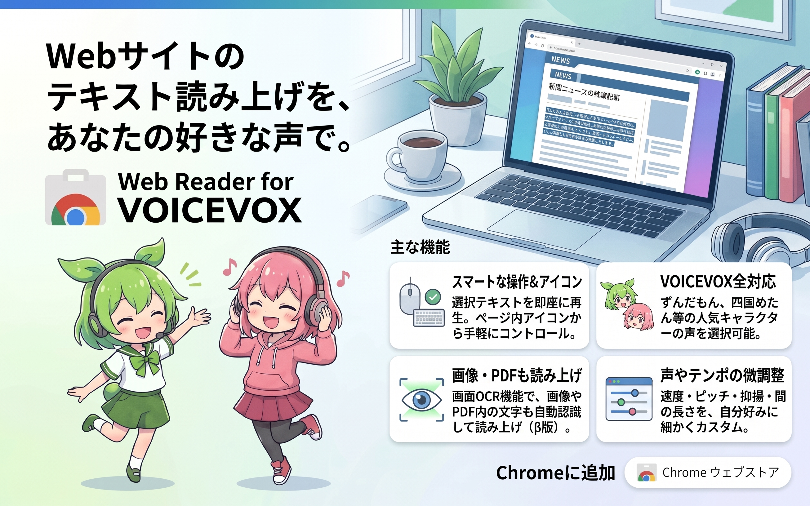

# Web Reader for VOICEVOX

WebページのテキストをVOICEVOXの声で読み上げる無料のChrome拡張機能です。画像やPDFの文字も読み上げられます（β版）。

[**Chrome ウェブストアで追加**](https://chromewebstore.google.com/detail/web-reader-for-voicevox/ilcfondcjhaalpcghnhcejioopcbhhla)

Chrome 119以降に対応しています。読み上げるには、PCに[VOICEVOX](https://voicevox.hiroshiba.jp/)をインストールして起動してください。

## 使い方

### 選択したテキストを読み上げる

Webページで文字を選び、`Alt+Shift+U`を押します。右クリックメニューからも読み上げられます。ページ内アイコンの左クリックで開始・停止できます。

### 画面上の範囲を読み上げる（β版）

ページ内アイコンを右クリック（初期設定）するか、`Alt+Shift+O`を押して、読みたい範囲をドラッグします。ページ上で取得できるテキストはそのまま読み上げ、画像やPDFなど直接取得できない文字はOCRで認識して読み上げます。右クリック時の動作はオプションで変更できます。縦書き・横書きは自動で判定します。

PDFビューアなど範囲を直接選べない画面では、キャプチャ画像が別タブに開きます。そこで範囲を選び、認識した文字を確認・編集して「読み上げる」を押します。

**β版の制限**

小説や電子書籍では、フォントや文字サイズ、ルビなどによって読み間違いや読み飛ばしが起こることがあります。なお、漫画の読み上げには対応できておりません。

認識には時間がかかることがあります。文字を拡大し、少し余白を含めて範囲を選ぶと読み取りやすくなる場合があります。

## 設定

Chromeツールバーの拡張機能アイコンを右クリックし、「オプション」を開きます。VOICEVOXのキャラクターや速度・音量などを設定できます。ページ内アイコンの見た目や大きさを変えたり、ドラッグで移動したりできます。

アプリを起動せず、音声合成エンジンだけを利用したい場合は、オプションの「VOICEVOXアプリを起動せずに使う（メモリ節約）」を開いてください。

## うまく使えないとき

- 読み上げが始まらない場合は、VOICEVOXを起動し、オプション上部に「エンジンに接続できています」と表示されるか確認してください。
- ショートカットが反応しない場合は、`chrome://extensions/shortcuts`で割り当てを確認してください。
- PCに保存したPDFを読み上げられない場合は、Chromeの拡張機能の詳細で「ファイルのURLへのアクセスを許可する」をオンにしてください。

## プライバシーと利用条件

読み上げる文章はPC上のVOICEVOXへ、画像の文字認識はブラウザ内で処理し、外部サーバーへは送信しません。[プライバシーポリシー](docs/PRIVACY.md)

音声を公開・商用利用する場合は、VOICEVOXと各キャラクターの利用規約に従い、「VOICEVOX:ずんだもん」などのクレジットを表記してください。[利用規約](docs/TERMS.md)

ページ内アイコンに使うキャラクター画像は、お使いのVOICEVOXから取得します。画像の権利は各キャラクターの権利者に帰属します（VOICEVOX:WhiteCUL、VOICEVOX:離途 ほか）。

## 開発とライセンス

ソースコードから試す場合は、`chrome://extensions/`でデベロッパーモードをオンにし、「パッケージ化されていない拡張機能を読み込む」でこのフォルダを選びます。[開発ガイド](CONTRIBUTING.md) · [OCRの検証記録](docs/OCR-ACCURACY.md)

ソースコードはMIT、同梱のOCRエンジンと日本語学習データはApache License 2.0です。[MIT License](LICENSE) · [Apache License 2.0](LICENSE-APACHE-2.0) · [同梱物の詳細](vendor/tesseract/LICENSE-NOTICE.md)

[開発を支援する](https://github.com/sponsors/ningengakushu-dot)
